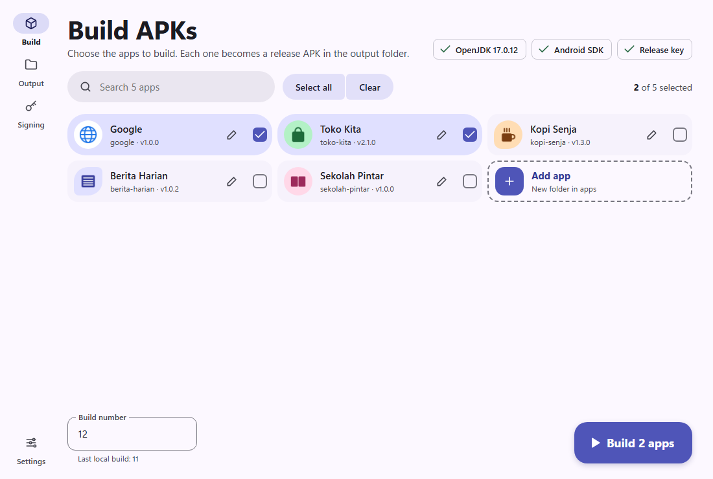
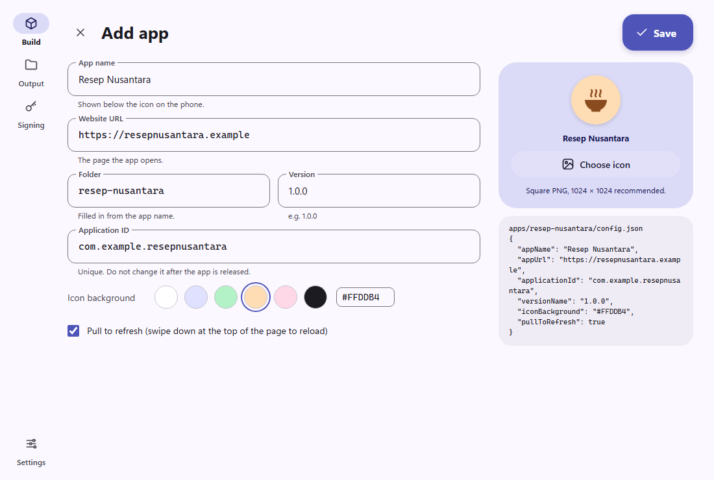
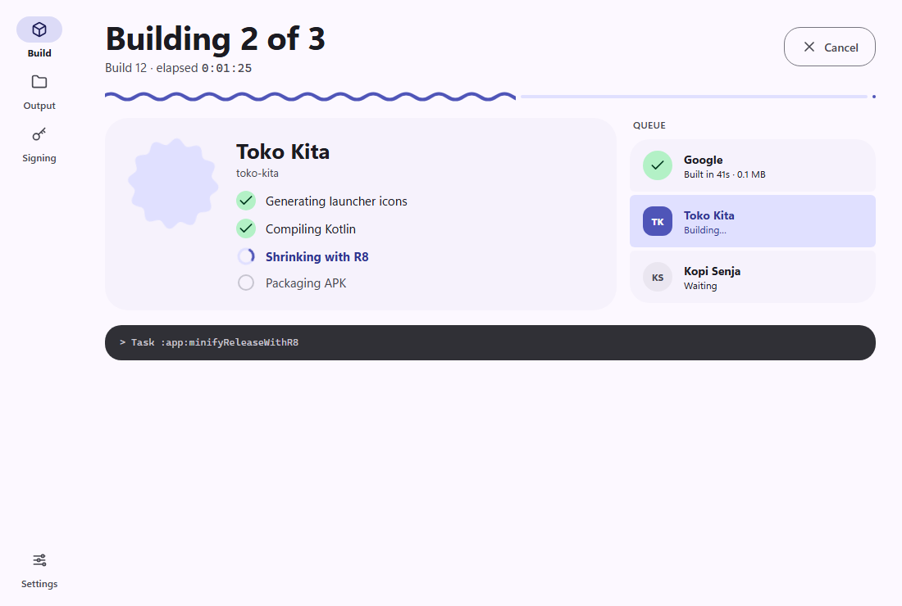
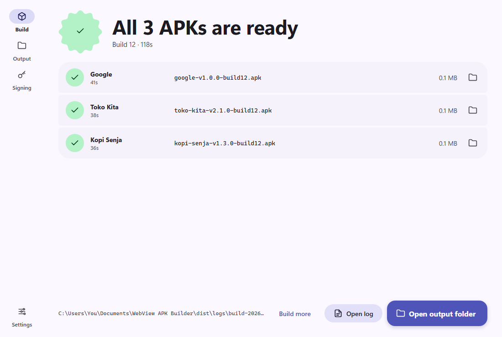
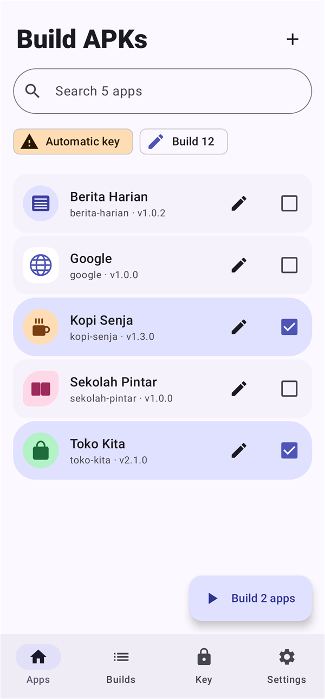
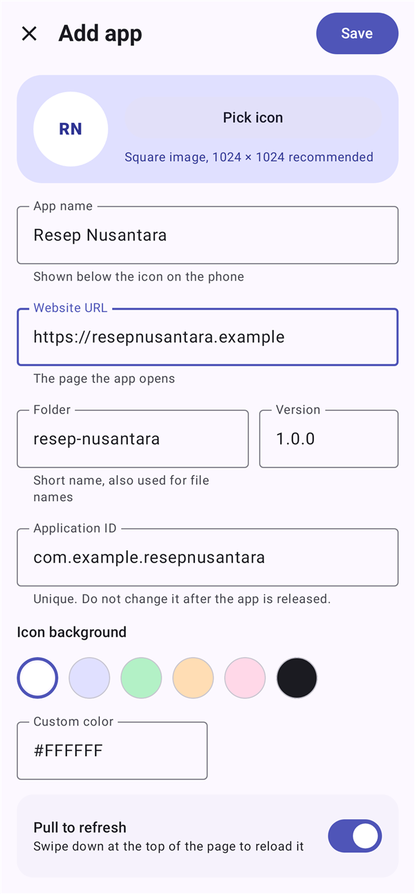
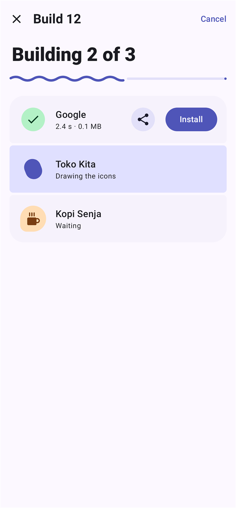
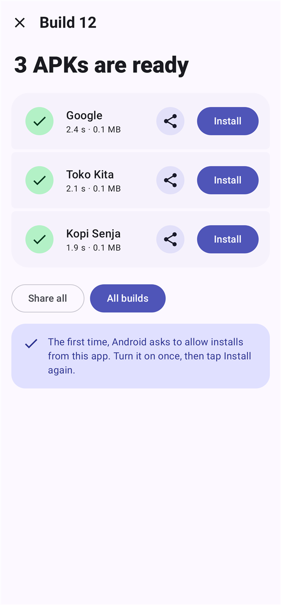
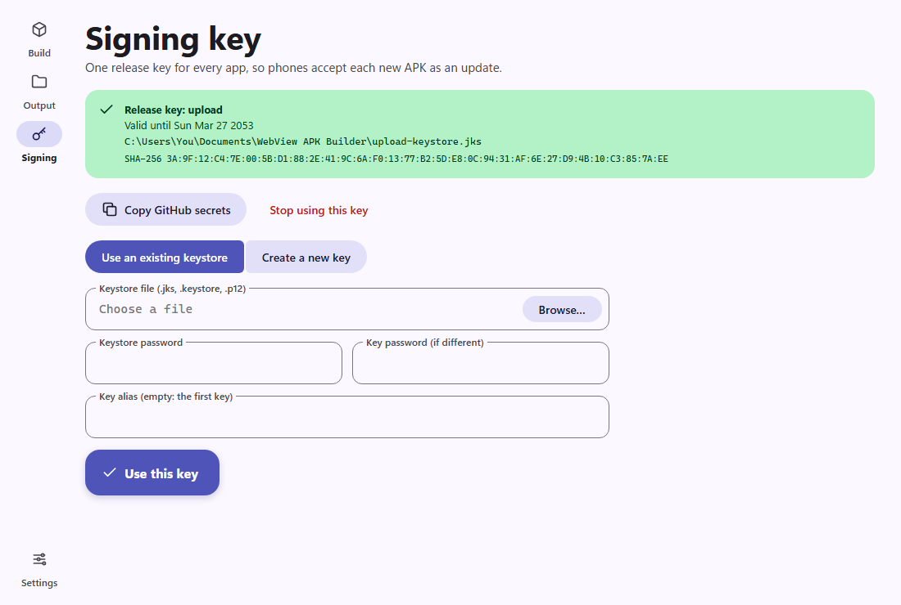
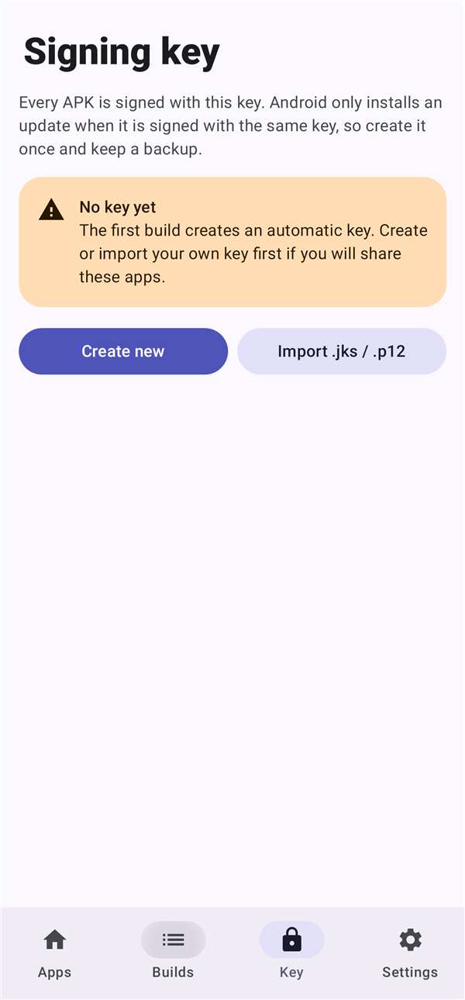

# WebView APK Builder

**Turn any website into an Android app in a few minutes.**

Type a name, paste a web address, pick an icon, and you get an app (an APK file)
that you can install on any Android phone. The app opens your website full
screen, with no browser bars, and it gets its own icon on the home screen.

You don't need to know how to code.

---

## Quick start

Choose the option that suits you:

| I want to... | Use this | What you need |
|---|---|---|
| Build apps on my **Windows PC** | [Desktop app](#option-1-desktop-app-windows) | A Windows PC. The app installs everything else for you. |
| Build apps **on my phone** | [Phone app](#option-2-phone-app-android) | An Android 8.0+ phone. Works offline, no account. |
| Build apps **in the cloud** | [GitHub Actions](#option-3-github-actions-advanced) | A free GitHub account |

Download the desktop and phone apps from the **[Releases](../../releases)** page.

---

## Option 1: Desktop app (Windows)

1. Download `WebView-APK-Builder-<version>-windows.exe` from
   [Releases](../../releases) and double-click it.
2. **First start only:** the app creates a folder at
   `Documents\WebView APK Builder` to keep your apps, builds and signing key.
   If Java or the Android SDK is missing, click **Install for me**. This
   downloads about 1 GB, one time only.
3. Click **Add app**, then enter:
   - **Name**: what shows below the icon, e.g. `My Shop`
   - **Website**: e.g. `https://myshop.com`
   - **Icon**: a square PNG image (1024 × 1024 looks best)
4. Tick the apps you want and click **Build**.
5. Check the summary and confirm. When the build finishes, click
   **Open folder** to find your APK.

| Choose the apps to build | Add an app |
|---|---|
|  |  |
| **Watch the build** | **Your APKs are ready** |
|  |  |

To change an app later, click its pencil button. You can also delete an app
from the edit screen. It goes to the Recycle Bin, so you can get it back.

> **Windows warning?** Windows SmartScreen may say the app is unrecognised.
> Click **More info**, then **Run anyway**.

## Option 2: Phone app (Android)

Build apps right on your phone, without a computer or internet.

1. Download `WebView-APK-Builder-<version>.apk` from [Releases](../../releases)
   on your phone and open it. If Android asks, allow **Install unknown apps**
   for your browser or file manager.
2. In the **Apps** tab, tap **Add app**, then fill in the name and website and
   pick an icon.
3. Tick the apps you want and tap **Build**.
4. When it finishes, tap **Install** to put the app on this phone, or
   **Share** to send it to someone else.

| Your apps | Add an app | Building | Done |
|:---:|:---:|:---:|:---:|
|  |  |  |  |

The other tabs:

- **Builds**: every APK you have built, ready to install, share, save or delete.
- **Key**: your signing key. Back it up! See [Updating your apps](#updating-your-apps).
- **Settings**: light, dark or pure black (AMOLED) theme, and wallpaper
  colours on Android 12+.

## Option 3: GitHub Actions (advanced)

GitHub can build your apps for you on its servers.

1. Fork or copy this repository to your GitHub account.
2. Add your app in the `apps/` folder (see [Adding an app by hand](#adding-an-app-by-hand)).
3. Go to the **Actions** tab, then **Build APK**, then **Run workflow**.
4. Enter the app's folder name (e.g. `google`), or `all` to build every app.
5. When it finishes, download your APK from the **Releases** page of your
   repository.

To sign your apps on GitHub, see [Signing on GitHub](#signing-on-github).

---

## What your app can do

Every app you build works like this:

- **Pull down to refresh**, just like in Chrome
- **Shows a friendly offline page** with a *Try again* button when there's no internet
- **Back button** goes to the previous page
- **File uploads** work (photos, documents)
- **Phone, email and WhatsApp links** open the right app
- **Stays logged in** after the app is closed
- **Pinch to zoom** where the website allows it
- **Videos and audio** can play automatically
- **English and Indonesian**, following the phone's language
- **Tiny download** (about 0.1 MB), runs on Android 7.0 and newer

You can build as many apps as you like and install them all on the same phone.

---

## Updating your apps

When you change something and want people to get the new version, keep two
things the same and change one:

### 1. Use the same signing key (important)

Android only accepts an update if it is signed with the **same key** as the
version already on the phone. If the key is different, people have to uninstall
the old app first, and they lose its data, such as their login.

- **Desktop app:** go to the **Signing** screen and either create a new key or
  choose one you already have.
- **Phone app:** go to the **Key** tab. A key is created automatically on your
  first build.

| Desktop: Signing screen | Phone: Key tab |
|:---:|:---:|
|  |  |

**Back up your key and its password somewhere safe.** If you lose it, you
can never update your apps again.

To use the same key on your phone and your PC, export it from one (phone:
**Export backup**; PC: the keystore file) and import it on the other.

### 2. Keep the same application ID

Every app has an ID like `com.myshop.app`. It is filled in for you when you add
an app. **Don't change it** after you've given the app to people: a new ID
makes it a different app.

### 3. Use a higher build number

Android only installs an update if its **build number** is higher than the one
on the phone. The builder suggests the next number for you, so usually you
can leave it as it is.

> If you build on more than one device (for example on your PC *and* your
> phone), each one counts on its own. Pick a number higher than any build
> you've given out before.

---

## Troubleshooting

**"App not installed" when updating**
The new APK was signed with a different key, or has a lower build number.
Use the same key and a higher build number (see [Updating your apps](#updating-your-apps)).
If you lost the key, uninstall the old app and install the new one.

**Two of my apps replace each other**
They have the same application ID. Give each app its own ID.

**The app shows a blank or error page**
Open the website in Chrome on the same phone to check that it works. Check
that the address starts with `https://` (or `http://` for a server on your
own network).

**The build fails on my PC**
Click **Open log** at the end of the build to see what went wrong. The full
log is also saved in `dist/logs/`. Make sure you have about 1 GB of free disk
space.

**Android blocks installing the APK**
Allow **Install unknown apps** for the app you're opening the APK with
(your browser, file manager or chat app).

---

## Adding an app by hand

Each app is a folder inside `apps/` with two files:

```
apps/
  my-shop/
    config.json   <- the app's settings
    icon.png      <- square PNG, 1024 × 1024 recommended
```

The easiest way is to copy `apps/google`, rename the folder, swap the icon and
edit `config.json`:

```json
{
  "appName": "My Shop",
  "appUrl": "https://myshop.com",
  "applicationId": "com.myshop.app",
  "versionName": "1.0.0",
  "iconBackground": "#FFFFFF",
  "pullToRefresh": true
}
```

| Setting | What it means |
|---|---|
| `appName` | Name shown below the icon. |
| `appUrl` | The website to open. Starts with `https://` or `http://`. |
| `applicationId` | The app's unique ID, like `com.company.app`. **Use a different one for every app** and never change it once people have the app. |
| `versionName` | The version people see, e.g. `1.0.0`. |
| `iconBackground` | *(optional)* Background colour behind the icon, e.g. `#FFFFFF`. Default is white. |
| `pullToRefresh` | *(optional)* Set to `false` to turn off pull to refresh. Default is on. |

If something is missing or wrong, the build stops and tells you what to fix.

---

## Signing on GitHub

To sign apps built by GitHub Actions with your own key, add these four
secrets under **Settings → Secrets and variables → Actions** in your
repository. The desktop app's **Signing** screen has a **Copy GitHub secrets**
button that fills them in for you.

| Secret | Value |
|---|---|
| `KEYSTORE_BASE64` | Your keystore file in base64. PowerShell: `[Convert]::ToBase64String([IO.File]::ReadAllBytes("upload-keystore.jks"))` |
| `KEYSTORE_PASSWORD` | Keystore password |
| `KEY_ALIAS` | Key alias, e.g. `upload` |
| `KEY_PASSWORD` | Key password (can stay empty if it's the same as the keystore password) |

Never commit your keystore or passwords to the repository.

---

## For developers

Building from source, using the terminal builder, the project layout, how
the phone builder works and how to publish a release are covered in
**[DEVELOPMENT.md](DEVELOPMENT.md)**.
